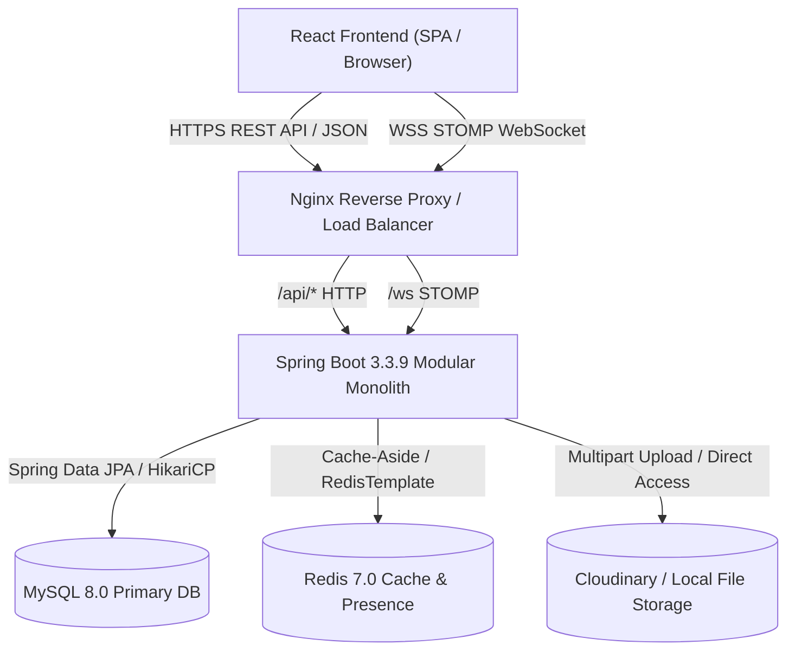
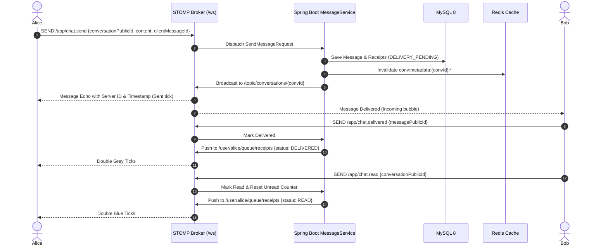
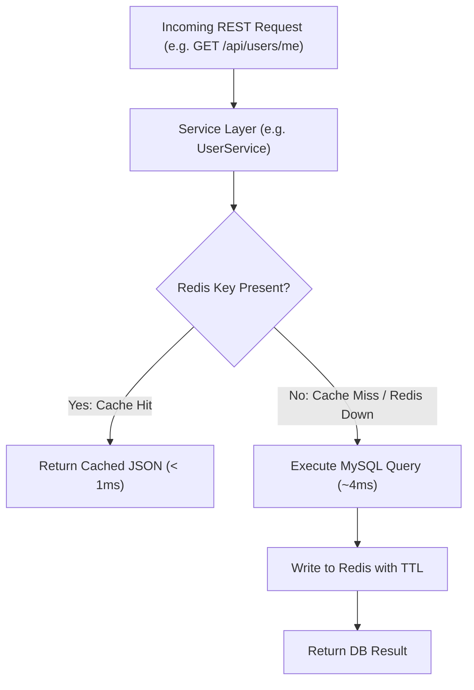

# ChatSphere Architecture & Technical Design

## 1. High-Level Architecture Overview

ChatSphere is designed as a modular monolith in Spring Boot 3.3.9 and Java 21, coupled with a reactive single-page frontend built on React 18, Vite, and Bootstrap 5.

---

## 2. Core Modules and Responsibilities

- **Authentication Module (`com.chatsphere.auth`)**:
  - Secure registration, BCrypt password hashing (cost factor 12).
  - JWT access tokens (15-min TTL) + HttpOnly rotating refresh tokens (7-day TTL).
  - Email verification token workflows and secure password reset.
  - In-memory sliding rate limiting (`AuthRateLimitingFilter`) allowing up to 30 requests/minute per client IP.
- **User Management & Contacts (`com.chatsphere.user`, `com.chatsphere.contact`)**:
  - Profile retrieval and update with immediate cache eviction.
  - Bidirectional contact relationships and mutual blocking enforcement.
  - Fine-grained privacy controls for online status, last seen, profile picture, and direct message permissions.
- **Conversations & Groups (`com.chatsphere.conversation`, `com.chatsphere.group`)**:
  - Private 1-on-1 conversations backed by deterministic sorted user pair hashes (`minId_maxId`).
  - Group conversations with role-based member management (ADMIN vs MEMBER), group avatar, description, and invite handling.
- **Messaging Engine (`com.chatsphere.message`)**:
  - Message persistence supporting `TEXT`, `IMAGE`, `VIDEO`, `DOCUMENT`, `AUDIO`, and `SYSTEM`.
  - Keyset cursor pagination for infinite upward scrolling without offset degradation.
  - Per-recipient delivery (`DELIVERED`) and read (`READ`) receipts with timestamps.
  - Message edits, "delete for me", "delete for everyone" (with 2-hour window), pin/unpin, and emoji reactions.
  - Full-text search with accessible conversation isolation.
- **WebSocket & Real-Time Engine (`com.chatsphere.websocket`)**:
  - STOMP over WebSocket with SockJS fallback at `/ws`.
  - STOMP handshake JWT validation via `WebSocketAuthChannelInterceptor`.
  - Topic destination access authorization (`/topic/conversations/{id}`) ensuring removed or non-members cannot snoop.
  - Ephemeral typing indicators and user presence tracking (`presence:user:{username}`) backed by Redis with configurable TTLs and graceful in-memory fallback.
- **Attachment Storage (`com.chatsphere.attachment`)**:
  - Pluggable storage abstraction (`FileStorageService`) with Cloudinary production driver and local-disk dev driver.
  - Magic-byte / file signature validation preventing disguised executables.
  - Cleanup routines on metadata persistence failures.
- **In-App Notifications (`com.chatsphere.notification`)**:
  - Triggered on new messages for offline/unread participants, group additions, member removals, and `@username` mentions.
  - Automatic deduplication suppressing redundant unread alerts.
  - Real-time user queue push via `/user/{username}/queue/notifications`.

---

## 3. End-to-End Real-Time Messaging Sequence

---

## 4. Redis Cache & Performance Flow

