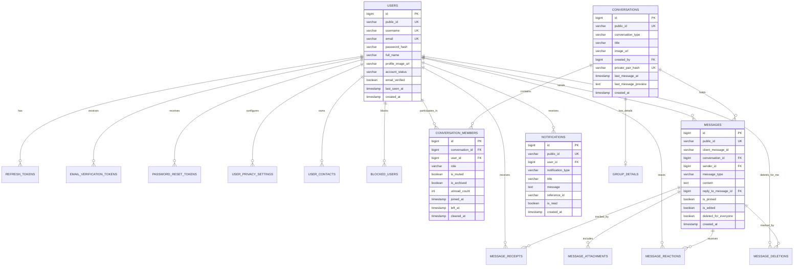

# ChatSphere Database Design & Entity Relationships

## 1. Entity-Relationship (ER) Diagram

---

## 2. Table Indexing & Performance Design

- **`messages`**:
  - `idx_messages_cursor (conversation_id, created_at, id)`: Powers high-performance cursor/keyset pagination.
  - `idx_messages_search_covering (conversation_id, deleted_for_everyone, created_at, id)`: Covering index for multi-conversation full text filtering.
  - `idx_messages_pinned (conversation_id, is_pinned)`: Fast retrieval of pinned announcements in chats.
- **`conversation_members`**:
  - `uk_conversation_user (conversation_id, user_id)`: Unique active membership constraint.
  - `idx_conv_members_user_cleared (user_id, cleared_at)`: Instant filtering of cleared conversation histories.
- **`notifications`**:
  - `idx_notifications_user_created (user_id, created_at)`: Reverse chronological notifications retrieval.
  - `idx_notifications_user_read (user_id, is_read)`: Fast unread notification counts.
  - `idx_notifications_dedup (user_id, notification_type, reference_id)`: Enforces deduplication logic.
